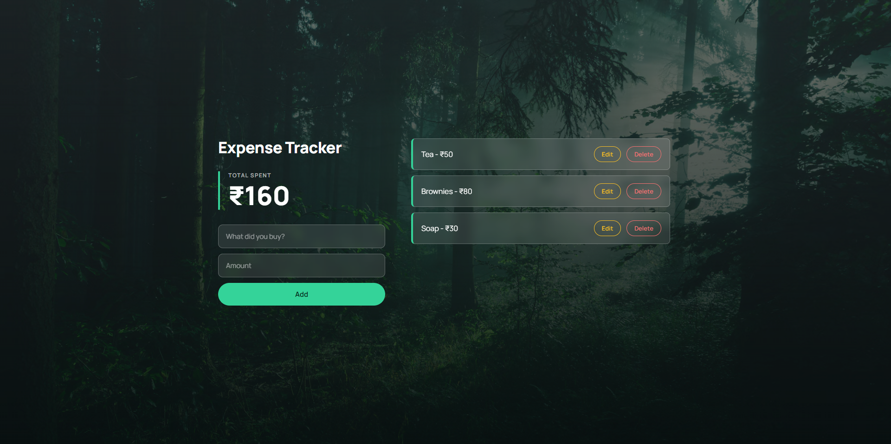

# Expense Tracker

A simple expense tracker built with HTML, CSS and JavaScript. Add what you spent, edit or delete it, and see your running total. Your data is saved in the browser, so it is still there after a refresh.

Live site: https://ordinaryphantom-lgtm.github.io/expense-tracker/

## Features

- Add an expense with a title and an amount
- Edit or delete any expense
- The total updates automatically
- Data is saved with localStorage, so there is no server and no sign-up

## Built with

- HTML
- CSS
- JavaScript (no libraries)

## What I learned

- Storing data as an array of objects
- Saving and loading data with localStorage (`JSON.stringify` and `JSON.parse`)
- Redrawing the list on the page after every change (add, edit, delete)
- Handling form submit and button click events

## Run it on your computer

1. Download or clone this repo
2. Open `index.html` in your browser

## Author

[404Architect](https://github.com/OrdinaryPhantom-lgtm)
